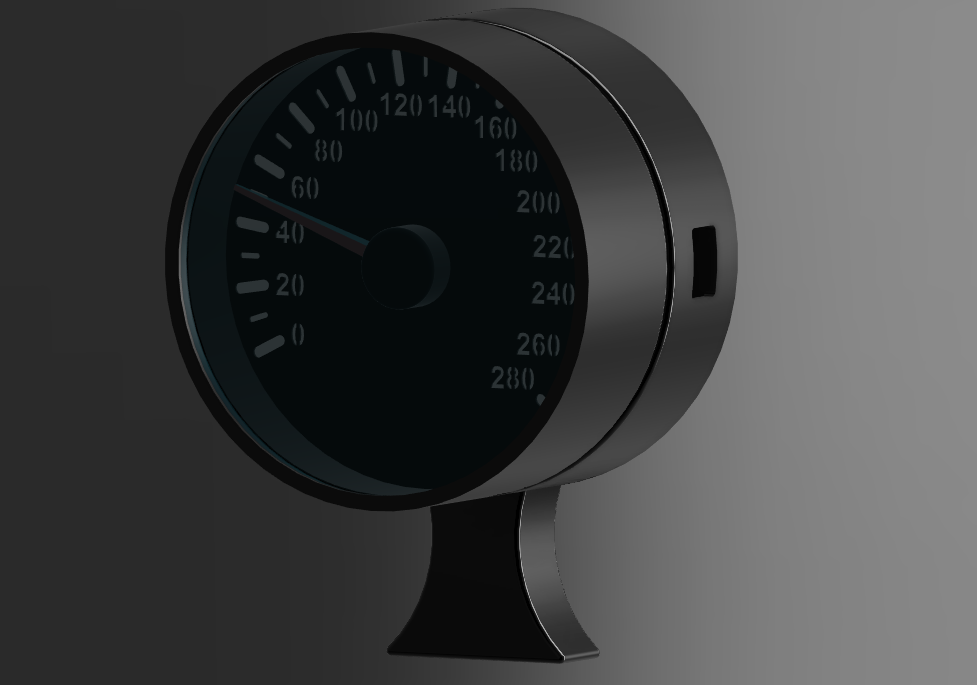
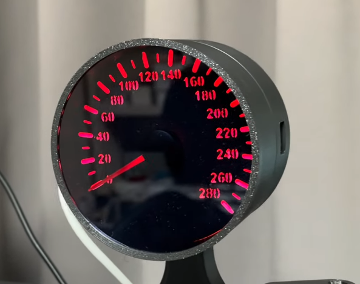
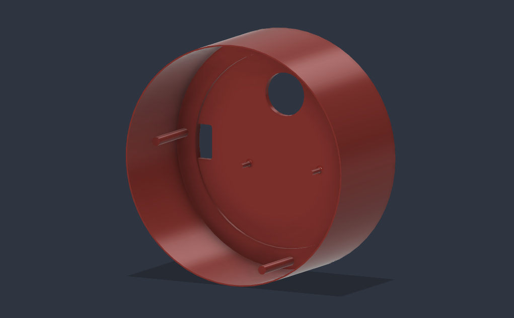
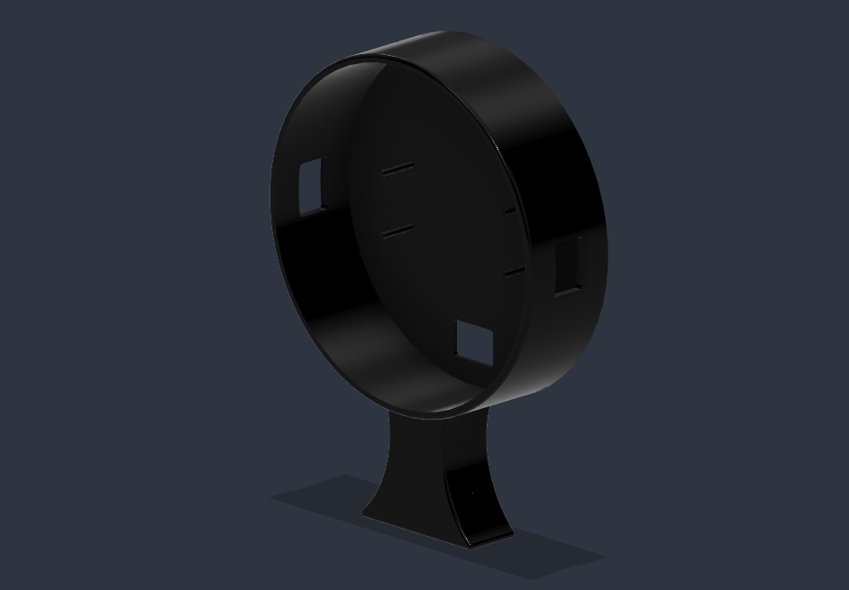
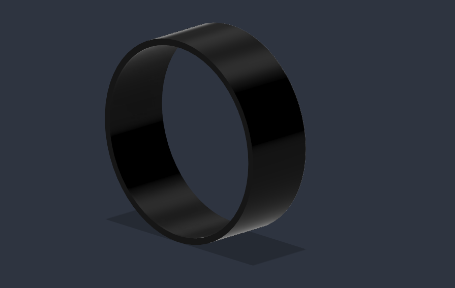
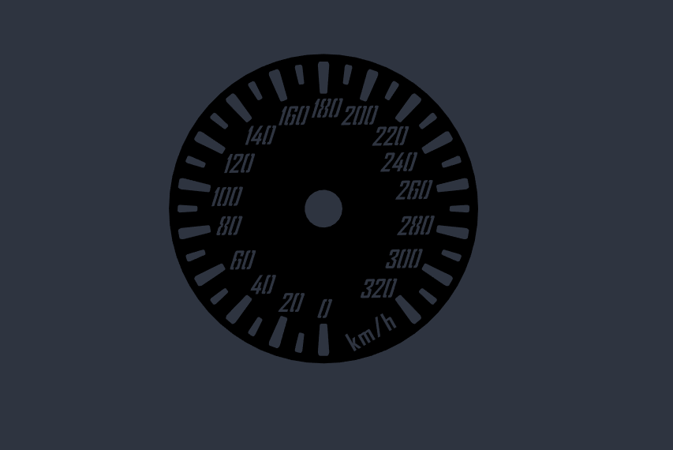
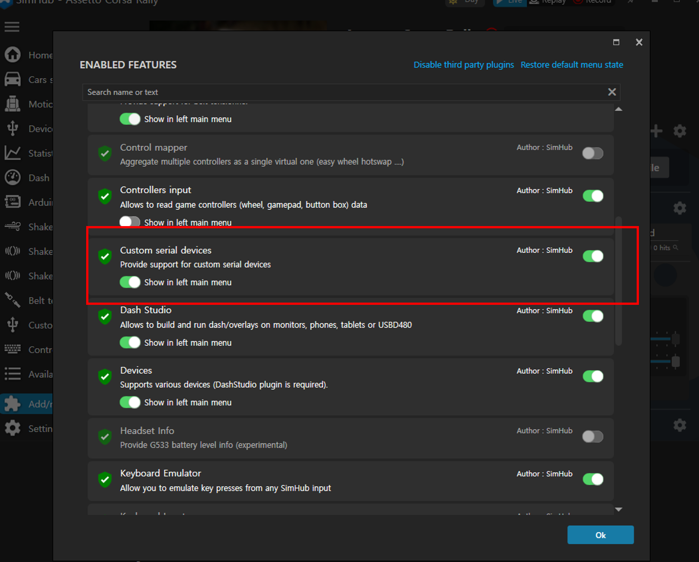
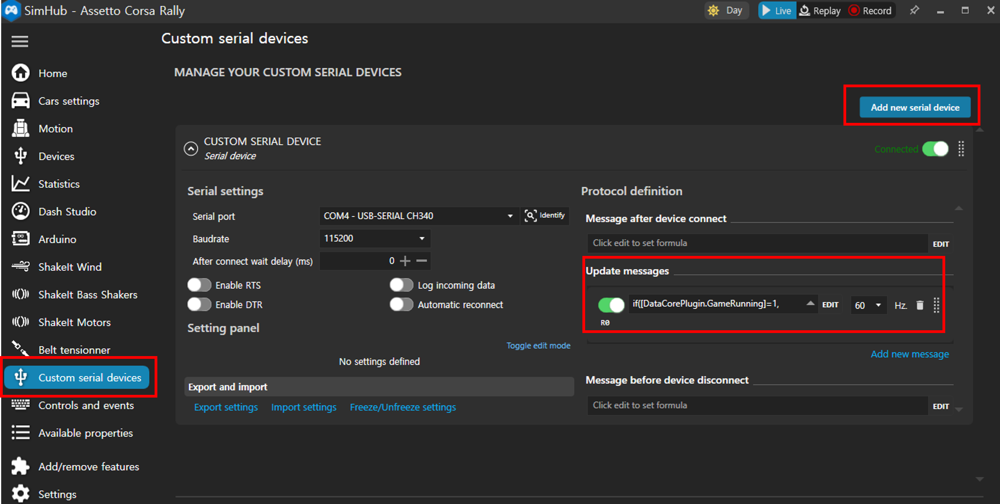
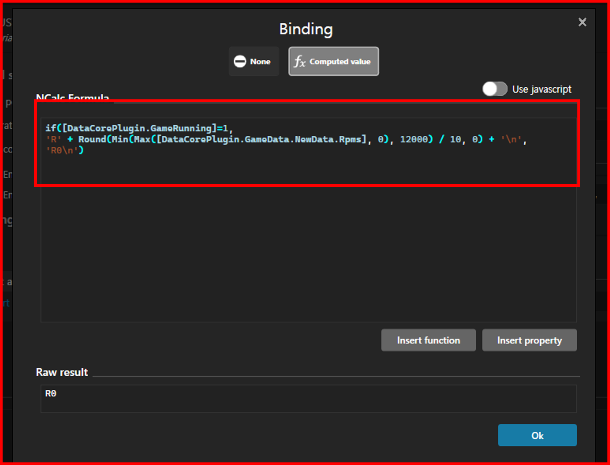

# TachoMeter

Speed(Km) / RPM 

## Credits

- **Design:** Lee Chiwon 
- **Development:** Lee Chiwon 
- **RGB Matix : ** Lee Chiwon

 

## 🎥 Video

---

# Hardware Wire

| Function    | Arduino | Ring LED Matrix | Single LED  | Motor  |
| ----------- | ------- | ------- | --------- |--------- |
| 5V                 | 5V          | 5V       | 5V          |
| GND                | GND         | GND      | GND         |
| Ring LED Matrix    | D6          | IN       |             |
| Single LED Bar     | D5          |          | IN          |
| Motor              | D9,D10,D11  |          |             | 1(D9), 2,3(D10), 4(D11)

 
---

# Part List 

|   Name              | EA | Site | Note | 
| ------------------- | ------ | --- | ------ |
| Arduino Nano   | 1 |  [Buy](https://smartstore.naver.com/misoparts/products/5779944205)| 국/내외 어디든 상관업음.
| Ring LED Matrix    | 1 |  [Buy](https://detail.tmall.com/item.htm?id=1035090948535&mi_id=0000gUlrvtFu5S64t1tqCFNuhOtfLKPjiB9Ap2ZIUPpeNy4&spm=tbpc.boughtlist.suborder_itempic.d1035090948535.37872e8dsNpH7A)| 16비트  WS2812 5050 RGB
| Single LED Bar    | 1 |  [Buy](https://detail.tmall.com/item.htm?id=1035090948535&mi_id=0000gUlrvtFu5S64t1tqCFNuhOtfLKPjiB9Ap2ZIUPpeNy4&spm=tbpc.boughtlist.suborder_itempic.d1035090948535.37872e8dsNpH7A)| 1비 WS2812 5050 RGB
| Motor    | 1 |  [Buy](https://item.taobao.com/item.htm?id=870730991204&mi_id=0000n-07sKJFhfhpx9YGWCMUwfIjtIyYDDo7LgTZTDCHjzY&spm=tbpc.boughtlist.suborder_itempic.d870730991204.37872e8dsNpH7A)| VID29-05
| Niddle    | 1 |  [Buy](https://item.taobao.com/item.htm?id=628805205024&mi_id=0000VkYcTL-KCI6JeJgxI6kfm_Xa8mfk7scPdLdVH7bH12c&spm=tbpc.boughtlist.suborder_itempic.d628805205024.37872e8dsNpH7A)| 36mm
| 광학산    | 1 |  [Buy](https://smartstore.naver.com/me41)| 2T 광학산/ 3D Print 폴더내 82.1mm 도면가지고 의뢰 하세요. 
| 스모그아크릴    | 1 |  [Buy](https://smartstore.naver.com/me41)| 3T 스모그/ 3D Print 폴더내 82.5mm 도면가지고 의뢰 하세요. 개당 1600원정도

# 3D Print

| Name |  EA  | Note |
| --- |  ------ |------ |
| 

  |  1EA  | 
| 

  |  1EA  | 
| 

  |  1EA  | 
| 

  |  1EA  | 
| 

  |  1EA  | 

# Simhub Setting
1. Add "Custom serial devices"

2. Add new serial device (Arduino Add)

3. Update Messages Edit

4. Serial Setting / (RTS & DTR OFF, Delay Time 4700ms)

5. Software_SimhubPlugin (Dll File Simhub Add)

 
 

# Simhub Arduino Uploading

펌웨어 업로드
Arduino IDE는 쓰지 않습니다. 플러그인을 새 파일로 바꾼 뒤에는 SimHub를 완전히 종료했다가 다시 실행하세요. 그 다음에 보드 선택, 스무싱 모드, 펌웨어 업로드 버튼이 보입니다.

같은 COM을 쓰는 SimHub 사용자 지정 시리얼을 먼저 끕니다. 포트를 잡고 있으면 업로드가 실패합니다.
큰 계기판은 BigTacho, 작은 계기판은 MiniTacho 탭에서 합니다. 탭이 다르면 다른 펌웨어가 들어갑니다.
COM을 선택합니다.
보드는 대부분 Nano 구 부트로더입니다. 신형 부트로더와 Uno만 115200입니다. 여기가 틀리면 업로드 자체가 안 됩니다.
스무싱을 쓸 게이지만 스무싱 모드를 체크합니다. 체크는 실행 중 전환이 아니라 다른 펌웨어를 넣는 선택입니다. 나중에 바꾸려면 다시 업로드합니다.
펌웨어 업로드를 누르고 확인을 누릅니다. 끝나면 상태가 "업로드 완료. 다시 연결하세요."로 바뀝니다.
그다음 연결을 눌러 보정으로 넘어갑니다. 연결은 펌웨어를 넣는 버튼이 아닙니다.

Firmware upload
Arduino IDE is not used. After replacing the plugin file, quit SimHub completely and start it again. The board list, smoothing checkbox, and firmware upload button appear after that restart.

Turn off the SimHub custom serial device that uses the same COM port. The upload fails while that port is held open.
Use the BigTacho tab for the large gauge and the MiniTacho tab for the small gauge. Each tab uploads a different firmware.
Select the COM port.
Most boards use Nano old bootloader. Only the new Nano bootloader and Uno use 115200. The wrong choice stops the upload.
Check Smoothing mode only for a gauge that should use it. The checkbox selects a different firmware. It does not switch modes while the gauge is running. Upload again to change it later.
Click Upload firmware and confirm. When it finishes, the status reads "Upload complete. Connect again."
Click Connect to start calibration. Connect does not upload firmware.

## 🇰🇷 사용 방법

1. SimHub가 연결되어 있다면 먼저 연결을 해제합니다.
2. Simhub의 software File에 있는 plugin을 simhub에 추가합니다.
3. **COM Port**를 선택한 후 **연결** 버튼을 클릭합니다.
4. 연결되면 바늘이 최대치까지 이동하며, EEPROM에 저장된 데이터를 자동으로 읽어옵니다. (EEPROM 읽어오는시간이 수초 발생됨)
5. **Speed** 또는 **RPM** 탭을 선택하여 사용하고자 하는 곳에 보정을 진행합니다.
6. 체크박스를 선택한 후 게이지를 조정하고 **보정값 전송** 버튼을 클릭하면 바늘이 움직입니다.
7. 보정이 완료되면 **EEPROM 저장**을 눌러 설정을 저장합니다.
8. **Reboot Arduino**를 실행하여 보정값이 정상적으로 적용되었는지 확인합니다.
9. **LED 설정** 탭에서 LED 색상과 밝기를 변경한 후 **색상 변경** 버튼을 눌러 변경 사항을 확인합니다.
10. 원하는 설정이 완료되면 **Save EEPROM**을 눌러 저장합니다.
11. **SimHub 식 복사** 탭에는 **RPM** 및 **Km/h**용 **Update Messages** 서식이 제공됩니다. (동시에 두개 사용은 불가능합니다.)
12. 원하는 서식을 복사하여 SimHub의 **Update Messages** 항목에 붙여 넣습니다.
13. Minitachometer도 동일한 방법으로 셋팅합니다.

---

## 🇺🇸 Usage

1. If SimHub is connected, disconnect it first.
2. Simhub Plugin Add.
3. Select the **COM Port**, then click **Connect**.
4. Once connected, the gauge needle will move to its maximum position, and the application will automatically load the data stored in the EEPROM (this may take a few seconds).
4.Select the Speed or RPM tab for the gauge you want to calibrate.
5. Check the checkbox, adjust the gauge, and click **Send Calibration Data**. The gauge needle will move accordingly.
6. When calibration is complete, click **Save EEPROM** to save the settings.
7. Click **Reboot Arduino** to verify that the calibration has been applied correctly.
8. In the **LED Settings** tab, adjust the LED color and brightness, then click **Apply Color** to preview the changes.
9. When you are satisfied with the result, click **Save EEPROM** to store the settings.
10. The **SimHub Formula Copy** tab provides **Update Messages** formats for both **RPM** and **KM/H** modes. (The Speed and RPM modes cannot be used simultaneously.)
11. Copy the desired format and paste it into the **Update Messages** field in SimHub.

